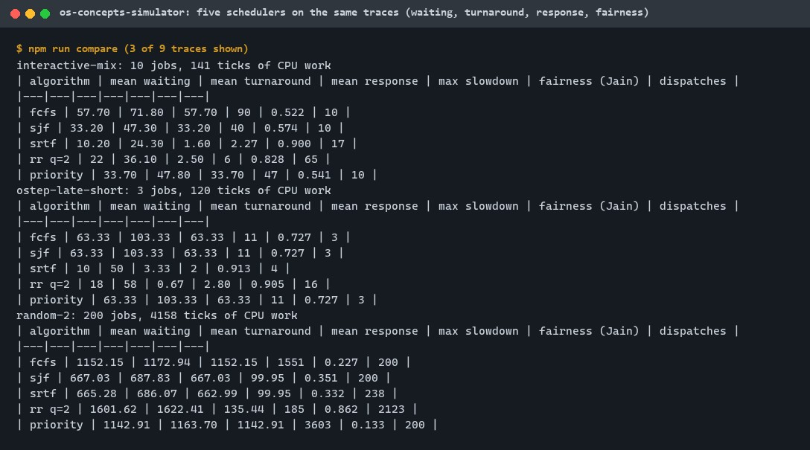
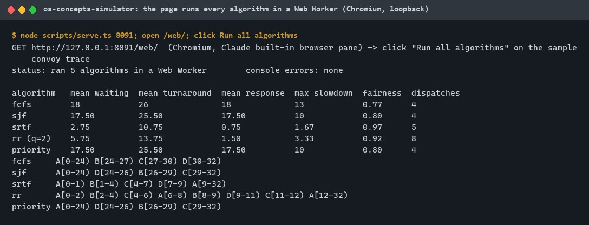
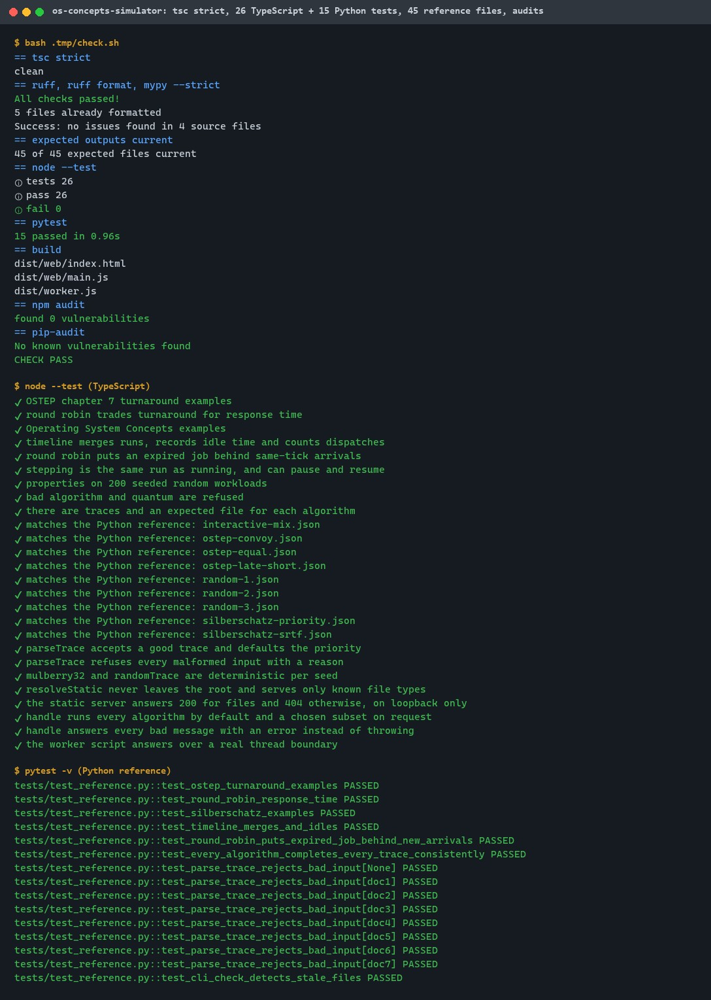
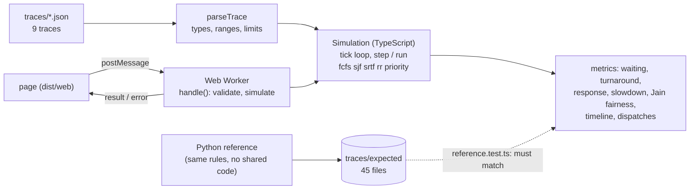
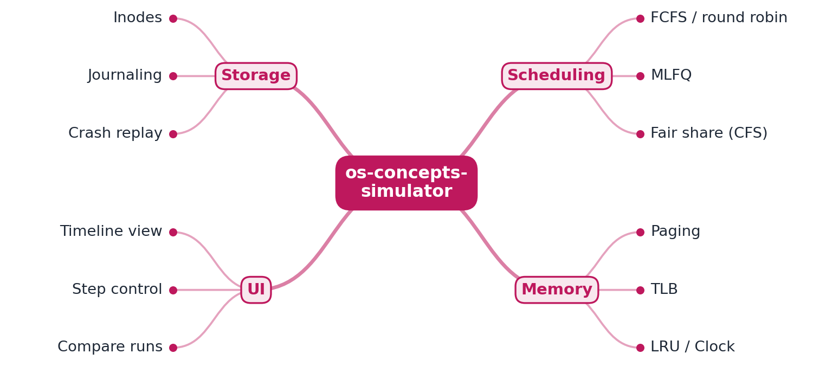

# os-concepts-simulator

[](https://github.com/EquinoxWN/os-concepts-simulator/actions/workflows/ci.yml)


> Makes CPU scheduling clickable: five schedulers you can pause and step through in the browser, checked against textbook results, no server needed.

Part of my **CS Foundations** list · TypeScript · Python

## Proof it works

FCFS, SJF, SRTF, round robin and priority scheduling run on the same traces and report waiting
time, turnaround, response time and fairness. On a mix of batch and interactive jobs SRTF waits
least (10.2 ticks on average) while round robin answers almost as fast (2.5) with 65 dispatches;
on 200 random jobs round robin is the fairest (Jain 0.862) and finishes last:



The page runs every algorithm in a Web Worker in the browser; the only server is a static file
server on 127.0.0.1:



41 tests pass: textbook results, 200 random workloads, every trace against an independent Python
reference, and a real worker thread; tsc strict, ruff, mypy, npm audit and pip-audit are clean:



## Architecture

**What M1 runs today:**



**Full roadmap (M1 to M3):**



## How it works

_Steps 1 and 2 are built and tested (M1); the rest is on the [roadmap](#roadmap)._

1. The simulation engine is written in TypeScript and runs in a Web Worker, so it needs no backend.
2. Scheduling algorithms run on the same job traces and report waiting time, turnaround and fairness.
3. The memory module simulates paging with a TLB and replacement policies (LRU, Clock, FIFO), counting page faults.
4. The storage module shows inodes and how journaling lets a file system recover after a simulated crash.
5. A React + D3 interface animates every step, so you can pause and compare algorithms side by side.
6. Python reference implementations generate expected outputs used to test the TypeScript engine.

In M1 time moves in integer ticks. At each tick, arriving jobs join the ready queue in trace order,
then the algorithm picks the job for that tick; ties go to the earlier arrival, then the earlier
trace position, and a round-robin job whose slice expired goes behind same-tick arrivals. `step()`
advances one tick (or one idle stretch) and reports what happened, so a run can be paused and
resumed; `run()` goes to the end. The Python reference of step 6 is already built and used as the
engine's test oracle (ADR 0002); the animated interface of step 5 is not.

## Who it helps

- **Who:** students and teachers of operating systems, and engineers reasoning about queueing,
  latency and fairness.
- **The problem:** textbook Gantt charts show one algorithm on one small example; the trade-offs
  only become visible when every algorithm runs on the same workload and you can change it.
- **What M1 does:** it runs five classic schedulers on any trace you give it, in the browser,
  and reports per-job and whole-run metrics, including fairness and starvation (maximum slowdown),
  with the textbook results and an independent reference as checks.
- **How to use it:** `make serve`, open `http://127.0.0.1:8080/web/`, edit the trace and run; or
  `make bench` for tables of every trace; or import `simulate` / `Simulation` from
  `js/src/engine/simulate.ts` in your own code.

## Tech stack

| Area | In M1 | Planned |
|---|---|---|
| Engine | TypeScript 7 (strict), tick-level simulation with step/run, FCFS, SJF, SRTF, RR, priority | Paging, TLB, LRU/Clock/FIFO (M2); inodes and journaling (M2) |
| Browser | Module Web Worker, minimal page (table, text timeline), static loopback server, CSP | React + D3 animated UI (M3) |
| Metrics | Waiting, turnaround, response, slowdown, Jain fairness, makespan, utilisation, dispatches | Page faults, TLB hit rate (M2) |
| Verification | Textbook cases, 200 random workloads, Python reference with 45 expected files | GIF of schedulers side by side (M3) |
| Quality | tsc strict, Node test runner, ruff, mypy --strict, pytest, npm audit, pip-audit, CI | |

Languages: **TypeScript** (engine, worker, page, Node 24) and **Python** (reference, 3.11+).

| Path | What it is |
|---|---|
| `js/src/engine` | Types, trace validation and seeded generator, simulation and metrics |
| `js/src/worker.ts` | Web Worker message handler |
| `js/src/web` | The page (`index.html`, `main.ts`) |
| `js/scripts` | `serve.ts` (static loopback server), `compare.ts` (all algorithms on all traces) |
| `python/src/os_concepts_simulator` | Reference schedulers and the expected-output generator |
| `traces`, `traces/expected` | Workloads and the reference outputs |

## Run it

Needs Node.js 24+, Python 3.11+ and make. Use a virtual environment for Python; build output stays
in git-ignored `js/dist`.

```bash
python -m venv python/.venv && . python/.venv/Scripts/activate   # Linux/macOS: python/.venv/bin/activate
make setup     # npm ci, pip install -e python[dev]
make lint      # tsc strict, ruff, mypy, expected outputs current
make test      # 26 TypeScript + 15 Python tests
make bench     # every algorithm on every trace
make serve     # build, then http://127.0.0.1:8080/web/
make audit     # npm audit, pip-audit
make expected  # regenerate traces/expected after changing a rule or a trace
```

## Tests and results

Latest local run (full detail in [docs/results/m1.md](docs/results/m1.md)):

| Test file | Tests | What it proves |
|---|---|---|
| `js/test/engine.test.ts` | 8 | OSTEP and Operating System Concepts results, round-robin conventions, step = run with pause and resume, invariants and SRTF optimality on 200 random workloads |
| `js/test/reference.test.ts` | 10 | All 45 trace and algorithm pairs equal the Python reference |
| `js/test/worker.test.ts` | 3 | Worker handler, error replies for 9 bad messages, a real thread boundary |
| `js/test/trace-serve.test.ts` | 5 | Trace validation and limits, deterministic generator, server path safety and loopback |
| `python/tests/test_reference.py` | 15 | The reference against the same textbook results, invariants, bad traces, stale-file check |

| Check | Result |
|---|---|
| Tests | 41 passed, 0 failed (26 TypeScript, 15 Python) |
| Lint and types | tsc strict, ruff, ruff format, mypy --strict: clean |
| Reference outputs | 45 of 45 current; engine matches all |
| Audit | npm audit: 0 vulnerabilities; pip-audit: none |
| Comparison | 9 traces x 5 algorithms in 1.0 s |
| Browser | page ran all algorithms in a Web Worker, no console errors (Chromium, local) |

| interactive-mix | Mean waiting | Mean response | Max slowdown | Fairness | Dispatches |
|---|---|---|---|---|---|
| fcfs | 57.70 | 57.70 | 90 | 0.522 | 10 |
| sjf | 33.20 | 33.20 | 40 | 0.574 | 10 |
| srtf | 10.20 | 1.60 | 2.27 | 0.900 | 17 |
| rr q=2 | 22 | 2.50 | 6 | 0.828 | 65 |
| priority | 33.70 | 33.70 | 47 | 0.541 | 10 |

CI runs lint, both test suites, the build, the comparison and both audits on every push; the
browser check was manual and local.

## Roadmap

**M1** (≈8 h)
- [x] Write `docs/rfc/0001-design.md`: problem, goals, non-goals, chosen design
- [x] The simulation engine is written in TypeScript and runs in a Web Worker, so it needs no backend.
- [x] Scheduling algorithms run on the same job traces and report waiting time, turnaround and fairness.

**M2** (≈8 h)
- [ ] The memory module simulates paging with a TLB and replacement policies (LRU, Clock, FIFO), counting page faults.
- [ ] The storage module shows inodes and how journaling lets a file system recover after a simulated crash.

**M3** (≈9 h)
- [ ] A React + D3 interface animates every step, so you can pause and compare algorithms side by side.
- [ ] Python reference implementations generate expected outputs used to test the TypeScript engine.
- [ ] Publish the proof below with real numbers

Built early in M1 and carried forward: the Python reference for the scheduling engine (step 6),
used as its test oracle; M3 extends it to the memory and storage modules.

## Proof

What this repo must show before it counts as done:

- A GIF comparing schedulers side by side, and trace-based test results.

| Result | Value |
|---|---|
| Trace-based test results | 45 of 45 trace and algorithm pairs match the Python reference; textbook cases pass (see [Tests and results](#tests-and-results)) |
| GIF comparing schedulers side by side | Not made yet (M3, with the animated interface) |

## Why it matters

- **Interview angle:** Operating-systems rounds: scheduling, page faults, and what fsync really guarantees.
- **Upstream I'd like to contribute to:** OSTEP homework simulators (Python): fixes, tests or ports.

## Design docs

- [RFC 0001: design](docs/rfc/0001-design.md)
- [ADR 0001: record architecture decisions](docs/adr/0001-record-architecture-decisions.md)
- [ADR 0002: test the TypeScript engine against a Python reference, built in M1](docs/adr/0002-python-reference-as-test-oracle.md)
- [M1 results](docs/results/m1.md)

## Scope

This is a learning and portfolio system, not a hosted production service. Everything runs in the
browser or locally; the static server listens on 127.0.0.1 only.

## Security and contributing

- Traces are validated (types, ranges, ids, size limits) before any simulation; the worker answers
  bad messages with an error; the page renders results as text nodes only, under a restrictive
  Content Security Policy.
- The static server serves only `dist/`, only known file types, refuses paths that leave the root
  or contain NUL bytes, sets `nosniff` and listens on loopback.
- Exact `typescript` and `@types/node` versions with a lockfile; every GitHub Action is pinned to a
  commit SHA; workflows run read-only, without persisted credentials.
- Dependabot update pull requests are paused (`open-pull-requests-limit: 0`) so the repository keeps a single `main` branch; dependencies are updated by hand and checked by the CI audit.
- tsc strict, ruff, mypy --strict and both test suites on every push; `npm audit` and `pip-audit` (`make audit`) in CI.
- Report vulnerabilities privately: see [SECURITY.md](SECURITY.md). To contribute, see [CONTRIBUTING.md](CONTRIBUTING.md).

## License

MIT, see [LICENSE](LICENSE).
